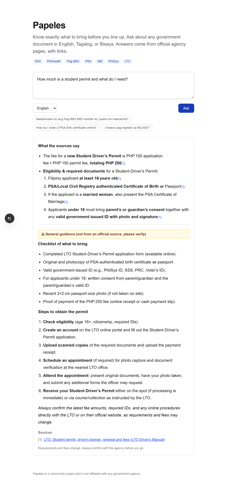
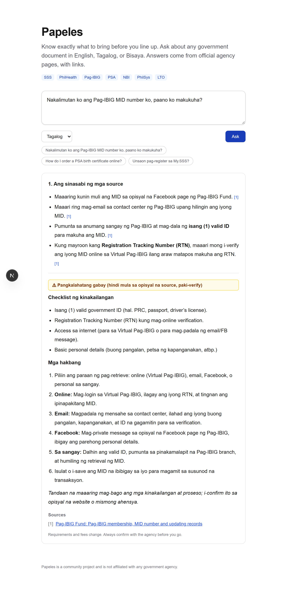

# Papeles

**Know exactly what to bring before you line up.**

Papeles answers questions about Philippine government paperwork (SSS, PhilHealth, Pag-IBIG,
PSA certificates, NBI clearance, PhilSys, LTO licenses) in English, Tagalog or Bisaya. Ask
"what do I need for X" and get a checklist and next steps, backed by official agency sources
with links.

<p align="center">
  
  &nbsp;
  
</p>

Every answer has two parts: facts from official sources, each cited `[1]` and linked, then
(only where the sources leave gaps) general guidance under an amber
**"not from an official source, please verify"** label.

## Why I built this

Almost everyone in the Philippines has gone home from a government office because one document
was missing. The information exists, but it's spread across many agency sites, often only in
English, and hard to search. Papeles puts it in one place and answers in your language.

## How it works

```
question ──► embed (multilingual, local) ──► pgvector similarity search
                                                     │
                                       top 5 official-page chunks
                                                     ▼
              the LLM answers ONLY from those chunks, citing [1], [2] ...
                                                     ▼
                                    answer + source links ──► web
```

1. `python -m app.ingest` loads each source in [`apps/api/data/sources.yaml`](apps/api/data/sources.yaml)
   (an official web page, an official PDF, or a checked summary file), splits it into
   overlapping chunks, embeds them, and stores them in the database.
2. A question is embedded with the same multilingual model, so a Tagalog or Bisaya question
   still matches English source text.
3. The closest chunks go to the LLM with instructions to answer only from them, cite them,
   and say so when the sources don't cover the question.

### Pick your AI provider

Set `LLM_PROVIDER` and `LLM_API_KEY` in `.env`. Groq, Gemini and OpenRouter have free tiers
that need no credit card. Without a key, Papeles still runs and shows the matching official
pages, just without a written answer.

| `LLM_PROVIDER` | Default model                            | Get a key                                 |
| -------------- | ---------------------------------------- | ----------------------------------------- |
| `groq`         | `openai/gpt-oss-120b`                    | https://console.groq.com/keys (free)      |
| `gemini`       | `gemini-flash-latest`                    | https://aistudio.google.com/apikey (free) |
| `openrouter`   | `meta-llama/llama-3.3-70b-instruct:free` | https://openrouter.ai/keys (free models)  |
| `claude`       | `claude-opus-5-5`                        | https://console.anthropic.com (paid)      |

Override the model with `LLM_MODEL`. Groq, Gemini and OpenRouter all speak the OpenAI chat
format, so one client in [`rag.py`](apps/api/app/rag.py) covers them; Claude uses the
Anthropic SDK.

## Stack

| Layer      | Tech                                                        |
| ---------- | ----------------------------------------------------------- |
| Web        | Next.js 16 (App Router), React 19, TypeScript, Tailwind CSS |
| API        | FastAPI, Pydantic, SQLAlchemy 2                             |
| Search     | PostgreSQL + pgvector, fastembed (multilingual MiniLM)      |
| AI         | Groq / Gemini / OpenRouter (OpenAI format) or Claude        |
| Tooling    | Docker Compose, GitHub Actions, pytest, Ruff, ESLint        |

## Run it locally

You need Docker and a free [Groq API key](https://console.groq.com/keys) (or any provider above).

```bash
cp .env.example .env          # then paste your LLM_API_KEY
docker compose up --build -d
docker compose exec api python -m app.ingest   # load the official pages
```

Open http://localhost:3000. API docs are at http://localhost:8000/docs.

### Without Docker (for development)

Set `DATABASE_URL=sqlite:///apps/api/papeles.db` in `.env` to skip Postgres entirely
(search then runs in Python, fine for a few hundred chunks), or start just the database:

```bash
docker compose up -d db

cd apps/api
python -m venv .venv && source .venv/bin/activate   # Windows: .venv\Scripts\activate
pip install -e ".[dev]"
uvicorn app.main:app --reload

cd apps/web
npm install
npm run dev
```

## Tests

```bash
cd apps/api && pytest        # API, no database, network or API key needed
cd apps/web && npm run lint && npm run typecheck
```

CI runs all of these on every push and pull request.

## Project layout

```
apps/
  api/            FastAPI service
    app/
      main.py       app + CORS + /health
      routers/      /ask endpoint
      rag.py        retrieval + LLM answer (Groq/Gemini/OpenRouter/Claude)
      ingest.py     fetch → chunk → embed → store
      chunking.py
      embeddings.py
      models.py     sources, chunks (pgvector)
    data/sources.yaml   official pages to answer from
    tests/
  web/            Next.js frontend
    src/app/        page + layout
    src/components/ask-box.tsx
    src/lib/api.ts
docker-compose.yml
.github/workflows/ci.yml
```

## Sources

Papeles only answers from official sources, listed in
[`sources.yaml`](apps/api/data/sources.yaml):

| Agency       | What's covered                                         | How it's loaded            |
| ------------ | ------------------------------------------------------ | -------------------------- |
| SSS          | Getting an SS number, all services in the 2026 Citizen's Charter, My.SSS | Official page and PDFs |
| PhilHealth   | Member Registration Form (PMRF); senior citizen coverage | Official PDF and web page |
| Pag-IBIG     | Membership sign-up, MID number, updating/merging records | Checked summary           |
| PSA          | Ordering birth/marriage/death certificates, CENOMAR    | Checked summary            |
| NBI          | Online clearance registration and renewal              | Checked summary            |
| PhilSys      | Contact details while the site is under maintenance    | Checked summary            |
| LTO          | Student permit, new license, renewal, fees             | Checked summary (LTO Driver's Manual) |

Many government sites block automated downloads or need JavaScript, so those agencies use short
summaries checked against the official page, under
[`apps/api/data/manual/`](apps/api/data/manual/README.md). Each one names its source page and
the date it was last checked.

**Not covered yet:** DFA passports. dfa.gov.ph blocks automated access, so someone needs to read
the official page and add a summary file. The manual README explains how.

When a question names an agency or one of its documents (e.g. "MID number" → Pag-IBIG,
"license" → LTO), search is limited to that agency's sources, and no page may supply more than
three chunks. Without this, the 1,500-chunk SSS Citizen's Charter crowds out the small pages.

## Roadmap

- [ ] Add a checked summary for DFA passports
- [ ] Personal checklist: tick off documents you already have, saved per user
- [ ] Office finder with hours and appointment links
- [ ] Stream answers token by token
- [ ] Scheduled re-ingest so answers track requirement changes
- [ ] Alembic migrations
- [ ] Deploy (Vercel for web, Render/Fly for API, Neon or Supabase for Postgres)

## Disclaimer

Papeles is a community project and is not affiliated with any government agency.
Requirements and fees change, so always confirm with the agency.
